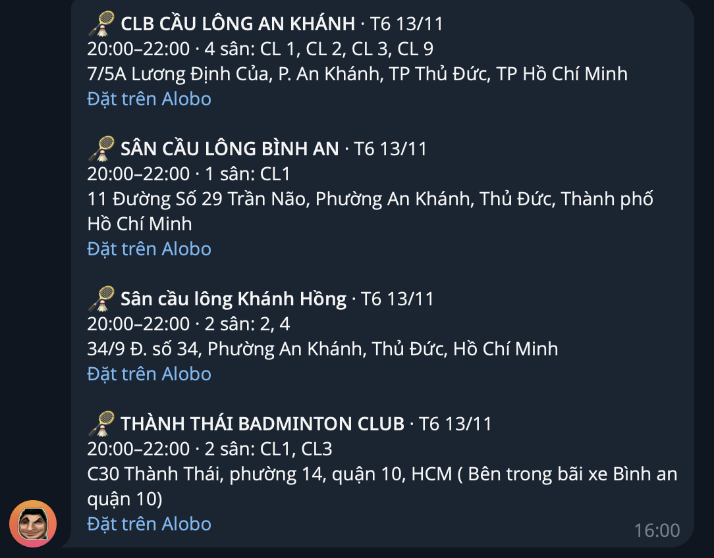
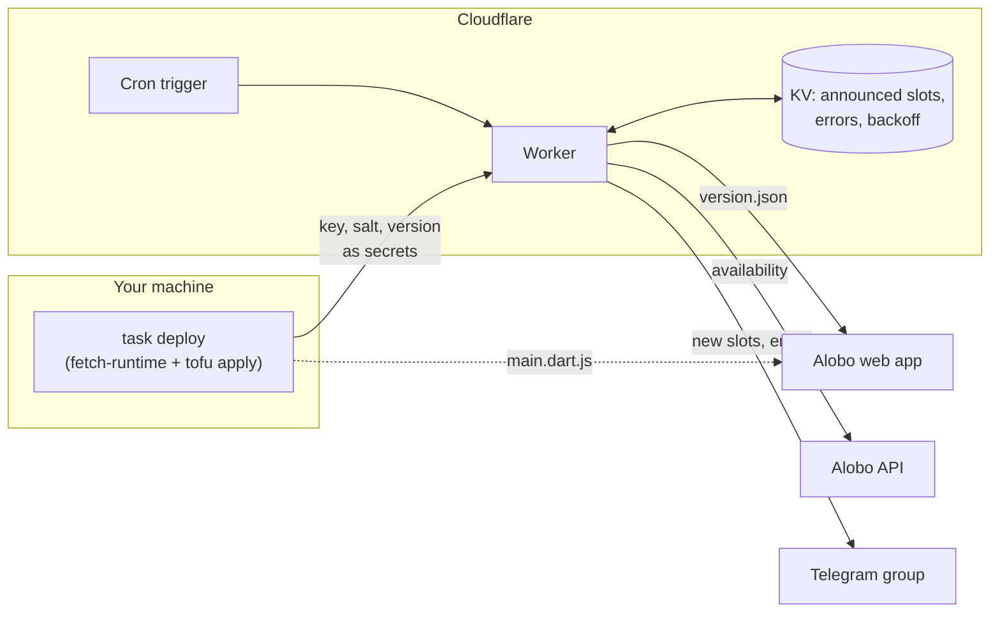

# courtping

Posts free badminton courts from [Alobo](https://datlich.alobo.vn) to a Telegram group, so whoever is
online can book before the slot is gone. Runs on the Cloudflare Workers free plan.





Alobo encrypts its API responses with a key embedded in its web bundle. The bundle is ~10 MB, too large to
parse within the free plan's 10 ms CPU limit, so the key is extracted on your machine at deploy time. Each
run checks `version.json` and asks for a redeploy when the frontend changes.

## Setup

Requires Node 26, pnpm, [Task](https://taskfile.dev), and [OpenTofu](https://opentofu.org).
The full walkthrough, from BotFather to Cloudflare, is in [SETUP.md](SETUP.md).

```sh
nvm use
cp .env.example .env                                                            # CLOUDFLARE_API_TOKEN
cp infra/cloudflare/terraform.tfvars.example infra/cloudflare/terraform.tfvars  # account, bot, venues, sessions
task dry-run    # one check against live Alobo, prints what it would send
task deploy
```

The API token needs *Workers Scripts: Edit* and *Workers KV Storage: Edit*. To get the group's chat id, add
the bot to the group, send a message, and read `chat.id` from
`https://api.telegram.org/bot<TOKEN>/getUpdates`.

| Command | |
|---|---|
| `task deploy` | refresh the key, build, apply (no prompt) |
| `task destroy` | remove the Worker, KV namespace, and cron (no prompt) |
| `task run` | trigger the deployed Worker now |
| `task status` | print the state stored in KV |
| `task local` | run one real check from your machine |
| `task test` | typecheck, unit tests, `tofu validate` |

OpenTofu state is local (`infra/cloudflare/terraform.tfstate`). Keep it until you have run `task destroy`.

## Searching Alobo

`packages/alobo/src/cli.ts` is a read-only JSON CLI for finding venues and free courts, also usable by
agents through the skill in `skills/alobo`:

```sh
task alobo:cli -- venues --near 10.7725,106.6980 --radius 4
task alobo:cli -- availability --venue an-khanh --date 2026-11-09 --from 19:00 --to 22:00 --duration 120
```

## Configuration

`infra/cloudflare/terraform.tfvars`:

```hcl
venues   = ["an-khanh", "level-up"]   # aliases or Alobo IDs (sport_...)
sessions = [
  { weekdays = ["tue", "thu"], from = "18:00", to = "21:00", duration_minutes = 120, courts = 2 },
]
lookahead_days = 7                    # days ahead to check
crons          = ["*/30 0-16 * * *"]  # UTC; every 30 min, 07:00-23:00 in Vietnam
```

A slot is announced once. If it gets booked and frees up again, it is announced again. One run checks at
most 40 time windows.

## Errors

The bot posts each new error to the group once and posts again when it recovers. On 401, 403, or 429 it
stops for `backoff_hours` (default 6). `frontend_changed` and `decode_error` mean the key is stale: run
`task deploy`. If `fetch-runtime` fails too, Alobo changed its bundle layout and
`packages/alobo/src/runtime.ts` needs updating. Telegram errors can only be seen in the Worker logs.

## Disclaimer

courtping is an independent project. It is not affiliated with, endorsed by, or supported by Alobo.
"Alobo" is used only to identify the service the tool reads from.

Alobo has no public API. This tool reads public availability data the same way Alobo's own web app does,
which involves reproducing the web app's request signing and response decryption. It does not book, pay,
log in, or access any account data. It may stop working at any time.

You are responsible for how you use it, including compliance with Alobo's terms of service and applicable
law. Keep the polling rate low. The software is provided "as is", without warranty of any kind; see
[LICENSE](LICENSE). If you represent Alobo and want this project changed or taken down, open an issue.

## License

[Apache-2.0](LICENSE)
